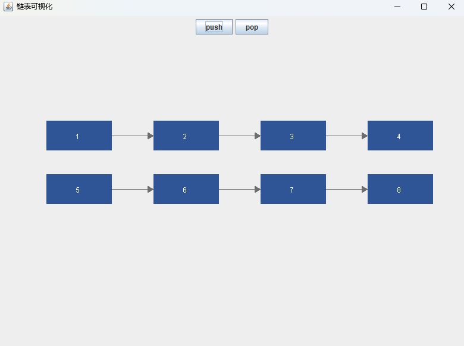

# 链表可视化（Linked List Visualizer）

用 Java Swing 写的链表可视化工具：把链表的结点画成方块，用箭头表示 next 指针，点按钮就能增删结点。

## 功能

- 启动时展示 1 → 2 → 3 三个结点
- 点 **push**：在链表尾部插入新结点，数值自增
- 点 **pop**：删除尾部结点
- 结点过多自动换行，不会跑出窗口

## 运行

需要 JDK 17。

```
javac ListView.java
java ListView
```

或用 IDEA 打开，点 `main` 左侧的绿色三角。

## 用到的数据结构

| 操作 | 做法 | 关键点 |
|---|---|---|
| 定义结点 | `class Node { int val; Node next; }` | 值 + 下一个结点的引用 |
| 遍历 | `for (Node p = head; p != null; p = p.next)` | 靠 null 结束，不是靠下标 |
| 尾插 | 走到最后一个结点后接上 | 循环条件 `p.next != null` |
| 尾删 | 停在倒数第二个结点后断开 | 循环条件 `p.next.next != null` |

## 关键实现

- 绘制入口：重写 `JPanel.paintComponent(Graphics g)`
- 数据变化后调用 `repaint()` 触发重绘
- 换行：绘制前判断 `x + w > getWidth() - 20`，放不下就回到行首、下移一行

## 截图



## 作者

XiaChi
